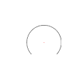
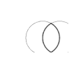
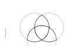
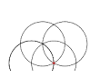
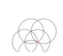
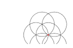
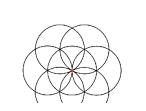
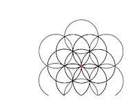
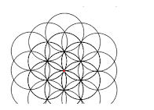
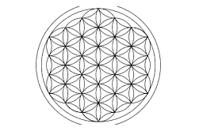

# Emergent Shape Instrument

### Theory of Emergence — Geometric Specification

> **Version** 2.0 — Geometric Realignment
> **Grounding** Flower of Life construction sequence
> **Canon** Frame–Gradient–Vector balance preserved

---

## Abstract

A single circle is drawn on a blank plane. A second circle, identical in size, is placed with its center on the circumference of the first. Two points of intersection appear. A third circle is placed on one of those points. Then a fourth.

By the fourth circle, every type of geometric relationship the construction will ever produce already exists. What follows is not new — it is the same rule, repeated, filling the field until no valid placement remains. The pattern that results is the Flower of Life: nineteen circles, dense with overlapping structure, all generated by one operation that never changed.

Then something different happens. A single bounding circle is drawn around the whole construction. This circle does not follow the rule that built the pattern. It does not sit on an intersection point. It does not create new intersections. It simply encloses. It says: *this is the pattern. What is inside the boundary is the Flower of Life. What is outside is not.* Identity is not something the pattern grew into. Identity is where someone chose to stop.

This document takes that construction and turns it into a diagnostic instrument. The claim is not that the Flower of Life explains anything. The claim is that its structure — a generative phase that produces novelty, a saturative phase that repeats without novelty, and a terminal act that imposes identity by enclosure — recurs across domains. Physics, biology, language, institutions: each can be examined for where its generative horizon falls, how it densifies under an unchanged rule, and whether its identity is drawn or grown.

The instrument requires three things to be present in any analysis: a field of unrealized possibility, a rule that constrains valid moves, and a directed selection among those moves. If any one is missing, the analysis is incomplete. If any one dominates, the analysis has collapsed. This constraint — called the Canon of Symmetry — is not negotiable.

What the instrument does not do is equally important. It does not make truth claims. It does not rank phenomena by depth or height. It does not explain consciousness, derive physical constants, or settle metaphysical disputes. It diagnoses structure. It identifies what is missing. It tells you where the rule changed and where the boundary was drawn. Everything else is the analyst's responsibility.

---

## I. Purpose

The Emergent Shape Instrument is a structural diagnostic tool grounded in the Flower of Life geometric construction. It applies a single repeated operation — place a circle of fixed radius with its center on an intersection point of existing circles — to reveal phase structure, generative horizons, and boundary conditions in any domain.

The instrument does not make truth claims. It diagnoses structure.

---

## II. Anchor Nodes

Three irreducible nodes form a closed operational loop called the Trinary Lock:

```
P1 (Field) --> H2 (Rule) --> O3 (Placement) --> P1 (Modified Field)
```

Each cycle of the loop is one construction step. The field (P1) presents valid positions. The rule (H2) constrains which positions are permitted. The placement (O3) selects one. The field is modified, and the loop begins again.

| Node | Definition | Canon Role |
|------|-----------|------------|
| **P1** | The construction field. All positions where a circle center could be placed. The space of unrealized possibility. | Frame (Ethos) |
| **H2** | The construction rule. Place a circle of radius *r* centered on an intersection point. Invariant across all layers. | Gradient (Logos) |
| **O3** | Directed placement. The selection of which valid intersection point receives the next circle. | Vector (Pathos) |

If any node is missing, the analysis is incomplete.
If any node dominates the other two, the analysis has collapsed.

---

## III. Construction Layers

Each layer is a construction operation — one step in a geometric sequence. Layers are not ranks, levels, or stages of ascending capability. They partition into three phases by structural criteria.

<br>

### Phase I — Generative (L1–L4)

*Each operation produces a geometric relationship not previously present in the construction.*

<br>

#### L1 — Origin



**Operation:** Place the first circle. One center, one circumference, one radius.

**What is new:** The construction field acquires its first object. The rule is established. No intersection points exist yet.

<br>

#### L2 — First Distinction



**Operation:** Place a second circle with its center on the circumference of the first.

**What is new:** Two circles overlap, creating two intersection points. The vesica piscis — the almond-shaped overlap region — is the first spatial distinction. A geometric figure exists that did not exist at L1.

<br>

#### L3 — Triangulation



**Operation:** Place a third circle with its center on one of the intersection points from L2.

**What is new:** Three-fold symmetry appears. The equilateral triangle is implicit in the three centers. The construction spans the plane — it is no longer confined to a line.

<br>

#### L4 — Generative Horizon



**Operation:** Place a fourth circle on the next available intersection point.

**What is new:** The founding rule is now fully determined. All subsequent placements follow from the same operation applied to geometrically equivalent intersection points. No future operation will produce a relationship type not already present in L1–L4.

**This is the generative horizon.** After L4, nothing structurally new appears.

<br>

> **Phase Transition.** Emergence of new geometric relationship types ceases at L4. The rule continues to operate, but from this point forward it produces only instances of relationships already established. The construction densifies without generating novelty.

<br>

### Phase II — Saturative (L5–L9)

*The same operation repeats. No new relationship types appear. The field densifies, locks into coherence, and becomes self-similar.*

<br>

#### L5 — Fifth Placement



**Operation:** Place a fifth circle on the next available intersection point.

**Character:** Repetition of the rule. New intersections are created, but all are geometrically equivalent to those from L1–L4. Densification begins.

<br>

#### L6 — Sixth Placement



**Operation:** Place a sixth circle. The ring around the origin is nearly complete.

**Character:** The construction approaches its first local closure. All positions adjacent to the origin are being filled.

<br>

#### L7 — Ring Completion



**Operation:** Place the seventh circle, completing the first ring around the origin.

**Character:** The Seed of Life forms — seven circles, six surrounding one. Self-similarity is now visible: each petal is a vesica piscis, the same relationship from L2 recurring at a larger organizational scale. The inner ring is complete and structurally rigid. Coherence locks.

<br>

#### L8 — Outer Propagation



**Operation:** Place circles on intersection points of the outer ring. The second concentric layer begins.

**Character:** The rule that built the inner ring propagates outward. No new geometry appears — only a second instance of the same structure. Self-similar across rings.

<br>

#### L9 — Field Saturation



**Operation:** Continue placing circles until all valid intersection points within the field are populated.

**Character:** The Flower of Life is complete. Nineteen circles. Every valid placement under the rule has been executed. The construction is maximally dense. The rule has exhausted its domain.

The saturative phase, taken as a whole, exhibits four characteristics:

- **Repetition.** The same operation (H2) applies at every step. Nothing changes in the rule.
- **Densification.** Intersections and overlapping regions increase monotonically.
- **Coherence locking.** Completed rings are structurally rigid. Removing any circle breaks the symmetry.
- **Self-similarity.** The vesica piscis (L2) and triangulation (L3) recur at every scale within the pattern.

<br>

### Phase III — Terminal (L10)

<br>

#### L10 — Enclosure



**Operation:** Draw a single circle centered on the origin that circumscribes the entire construction.

**Character:** This is a categorical rule change. L1 through L9 all followed the same operation: place a circle centered on an intersection point. L10 does not follow this rule. Its center is the origin — not an intersection of the outer ring — and its purpose is not to create new intersections but to *terminate* the construction.

L10 is defined by five properties:

1. It is not an application of the construction rule (H2). It is a different operation entirely.
2. It does not generate new intersections for further placement.
3. It defines the pattern's identity by enclosure — what is inside the boundary is the Flower of Life; what is outside is not.
4. Identity is therefore a stop condition, not an emergent property of the construction.
5. The boundary could be drawn at a different radius, producing a different pattern. Identity is relative to where enclosure occurs.

---

## IV. Three Laws

These are the invariants of the instrument. Any application must satisfy all three. If an application violates a law, the application is invalid — not the law.

<br>

**Law 1 — Trace Persistence**

Every circle placed remains. No operation erases a prior circle. Each placement constrains which future placements are available.

*Test:* Given a construction at step N, can all prior circles (1 through N-1) be identified? If yes, Trace Persistence holds.

<br>

**Law 2 — Scale Recurrence**

A geometric relationship that appears at one layer recurs at subsequent layers with different parameters but preserved structure.

*Test:* The vesica piscis (L2) recurs as each petal of the Seed of Life (L7) and again in the outer ring (L8–L9). Triangulation (L3) recurs in every trio of adjacent circles. If these recurrences are present, Scale Recurrence holds.

<br>

**Law 3 — Lossy Encoding**

The completed pattern does not contain all information about the construction sequence. Multiple construction orders can produce the same final pattern.

*Test:* Can two different construction orders produce the same Flower of Life? If yes, the final pattern is a lossy encoding of the process. Any analysis that treats the final pattern as uniquely determining its construction history has exceeded what the geometry supports.

---

## V. Four Operators

Every move the instrument makes is composed of these four operations.

| Operator | Definition | Input / Output |
|----------|-----------|----------------|
| **Placement** | Select one intersection point from the valid set and place a circle. | Valid set + Rule H2 produces new circle |
| **Recurrence** | The same rule applied to its own output. Each circle creates intersections that become inputs for the next application. | Step N produces intersections, producing Step N+1 |
| **Entrainment** | Adjacent circles share intersection points. Their constraints combine. Available placements are determined by joint geometry, not by either circle alone. | Circle A + Circle B produces shared constraint field |
| **Attractor Bias** | As density increases, certain intersections are determined by more overlapping circles than others. High-multiplicity points are geometrically privileged — they are where the pattern converges. | Dense field + overlapping constraints produces biased selection |

---

## VI. Allowed Moves

When applying the instrument to any domain, these operations are permitted:

1. **Phase Assignment.** Identify whether a phenomenon is in a generative phase (producing new relationship types), a saturative phase (same rule repeating on a denser field), or at a terminal boundary (identity by enclosure).
2. **Generative Horizon Detection.** Determine the point at which the system ceased producing new structural relationships. Everything after that point is saturation, not emergence.
3. **Saturation Analysis.** Characterize how the system densifies, where coherence locks form, and where self-similarity appears.
4. **Boundary Detection.** Identify where identity is imposed by enclosure rather than generated by the rule.
5. **Operator Application.** Apply Placement, Recurrence, Entrainment, or Attractor Bias to model a transition.
6. **Trinary Audit.** Check whether P1, H2, and O3 are all present and in balance. If not, identify which node is missing or dominant.
7. **Cross-Domain Mapping.** Map a structural relationship stable at one layer in domain A to a corresponding layer in domain B. Licensed by Law 2, but must be tested — not assumed.
8. **Rule Extraction.** Identify the invariant rule governing the system. If the rule changes, locate the change and classify it as generative extension or terminal boundary.

---

## VII. Prohibited Moves

These moves are structurally invalid. Any analysis that performs them has failed.

1. **Node Collapse.** Treating one anchor node as reducible to another. P1 is not H2. O3 is not P1. Each is irreducible.
2. **Hierarchy Projection.** Describing saturative layers as "higher," "deeper," or "more capable" than generative layers. Later layers are later placements, not elevated states.
3. **Emergent Identity.** Treating identity as something that arises from the construction. Identity is imposed by enclosure at L10. It is a boundary condition, not an emergent property.
4. **Layer Skipping.** Claiming a system jumps from L1 to L9 without accounting for intermediate operations.
5. **Unfalsifiable Assignment.** Assigning a phenomenon to a layer without specifying what evidence would disconfirm the assignment.
6. **Metaphor Substitution.** Using a metaphor in place of an operational mapping. Metaphors may illustrate; they may not replace specification.
7. **Completeness Claims.** Asserting the instrument explains everything about a domain. Law 3 applies to the instrument itself.
8. **Truth Claims.** Asserting the instrument is true. Instruments are evaluated by coherence, reusability, and yield — not by truth-value.
9. **Observer Privileging.** Treating observation, interpretation, or consciousness as a layer function. These are external mappings, not construction operations.
10. **Saturation-as-Ascent.** Describing the saturative phase as "growth," "development," "deepening," or "transcendence." Saturation is the same rule repeating on a denser field. It is not progress.

---

## VIII. Diagnostic Protocol

For any system, theory, or phenomenon under analysis, execute the following steps in order:

**Step 1 — Field (Frame)**
Identify P1. What is the space of unrealized possibilities? What is the construction field before any operation has been applied?

**Step 2 — Rule (Gradient)**
Identify H2. What invariant operation governs valid moves? Does the rule remain constant across layers? If it changes, where?

**Step 3 — Selection (Vector)**
Identify O3. Which valid operation is selected at each step? What determines the selection?

**Step 4 — Phase Map**
Assign the phenomenon to one or more phases:

- Generative (L1–L4): Are new relationship types being produced?
- Saturative (L5–L9): Is the same rule repeating on a denser field?
- Terminal (L10): Has a boundary been drawn? Is identity imposed?

Specify evidence for each assignment. Specify what would falsify each assignment.

**Step 5 — Generative Horizon**
Identify the point at which new structural relationships cease. Everything after this point is saturation.

**Step 6 — Saturation Analysis**
How does the system densify under continued rule application? What coherence locks form? Where does self-similarity appear?

**Step 7 — Boundary Detection**
Is there a terminal operation categorically different from the construction rule? If so, does it impose identity by enclosure? If not, is the system unbounded — and what does that imply?

**Step 8 — Law Check**
Does the system satisfy Trace Persistence? Scale Recurrence? Lossy Encoding? If any law is violated, the system is structurally unstable at that point.

**Step 9 — Operator Trace**
Which operators are active? Which are absent? What does the absence imply?

**Step 10 — Balance Check (Canon)**
Is P1 being reduced to H2 or O3? Is H2 being ignored? Is O3 dominating? Does the analysis treat any layer as hierarchically superior? If any of these conditions hold, repair before proceeding.

---

## IX. Failure Modes

| Mode | Signature | Mitigation |
|------|-----------|------------|
| Pattern Projection | Instrument patterns seen where they don't structurally exist | Every assignment requires a falsification condition |
| Hierarchy Reimposition | "Deeper," "higher," "transcendent" applied to L5–L9 | Prohibited Moves 2 and 10 |
| Emergent Identity | "The system becomes aware of itself" | Prohibited Move 3 — identity is enclosure |
| Metaphor Leakage | Poetic language substituted for operational terms | Every claim must restate in operational vocabulary |
| Completeness Overreach | Instrument "resolves" a foundational problem | Distinguish diagnosis from resolution |
| Canon Violation | One node dominates (P1, H2, or O3) | Step 10 — Balance Check |
| Domain Flattening | Two domains mapped to same phases, concluded identical | Law 2: structure recurs, instances are not identical |

---

## X. Instrument Boundaries

**The instrument is useful for:**

- Structural diagnosis of theories and systems (phase analysis, gap detection)
- Identifying generative horizons — where new structural relationships cease
- Detecting missing boundary conditions
- Cross-domain pattern identification, with falsification conditions attached
- Generating research directions, not specific predictions

**The instrument is not useful for:**

- Deriving quantitative predictions
- Replacing domain-specific formalisms
- Settling metaphysical disputes
- Ranking systems or phenomena by "level" or "depth"
- Clinical, therapeutic, or spiritual practice

---

*Layers are operations, not ranks. Emergence is bounded. Identity is enclosure. No role dominates. Balance is dynamic non-collapse under lawful motion.*
